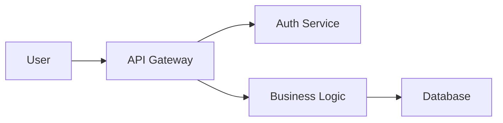
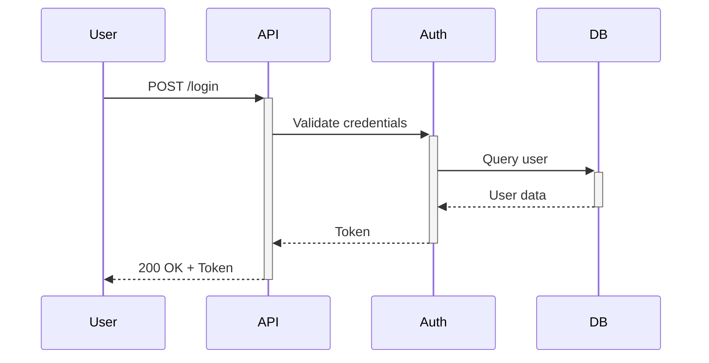

# 文档结构标准

> **语言**: [English](../../../core/documentation-structure.md) | [繁體中文](../../zh-TW/core/documentation-structure.md) | 简体中文

**Version**: 1.5.0
**Last Updated**: 2026-03-17
**Applicability**: 所有需要文档的软件项目
**Scope**: partial
**Industry Standards**: Diátaxis Framework (diataxis.fr)
**References**: [diataxis.fr](https://diataxis.fr/)

---

## 目的

本标准为软件项目定义了一致的文档结构，确保信息组织有序、可被发现且易于维护。

---

## 文档分类 (Diátaxis)

所有文档应根据 [Diátaxis framework](https://diataxis.fr/) 分为四种类型之一。这种明确的分类有助于读者找到正确的文档，并帮助编写者专注于正确的内容。

### 四种文档类型

| Type | Purpose | User Need | Orientation | Example |
|------|---------|-----------|-------------|---------|
| **Tutorial** | 面向学习 | “我想学习” | 实践步骤 | 入门指南、首个项目演练 |
| **How-to** | 面向任务 | “我想完成 X” | 实践步骤 | 部署指南、迁移检查清单 |
| **Reference** | 面向信息 | “我需要查阅 Y” | 理论知识 | API 参考、配置参数 |
| **Explanation** | 面向理解 | “我想理解为什么” | 理论知识 | 架构概览、ADR、设计原理 |

### 文档类型头部

在文档头部添加 `Document Type` 字段以进行明确分类：

```markdown
**Document Type**: Tutorial | How-to | Reference | Explanation
```

### 与标准文档的映射

| Standard Document | Diátaxis Type | Rationale |
|-------------------|---------------|-----------|
| README.md | Tutorial / How-to | 快速入门导向 |
| getting-started.md | Tutorial | 循序渐进式学习 |
| ARCHITECTURE.md | Explanation | 理解系统设计 |
| API Reference | Reference | 查阅端点 |
| DEPLOYMENT.md | How-to | 任务：部署系统 |
| MIGRATION.md | How-to | 任务：迁移系统 |
| ADR/ | Explanation | 理解决策 |
| troubleshooting.md | How-to | 任务：解决问题 |
| CHANGELOG.md | Reference | 查阅变更历史 |
| 流程文档 | Reference / Explanation | 理解数据流 |

---

## LLM 发现文件

发布供外部使用之文档的项目应考虑提供针对 LLM 优化的发现文件，类似于搜索引擎的 `robots.txt`。

### llms.txt 标准

`llms.txt` 文件（放置在项目或站点根目录）为基于 LLM 的检索系统提供结构化索引。

**Format**:

```markdown
# Project Name

> Brief one-line description of the project.

## Documentation

- [Getting Started](docs/getting-started.md): Tutorial for new users
- [API Reference](docs/api-reference.md): Complete REST API documentation
- [Architecture](docs/architecture.md): System design and component overview

## Optional

- [CHANGELOG](CHANGELOG.md): Version history
- [Contributing](CONTRIBUTING.md): Contribution guidelines
```

### 何时创建 llms.txt

| Scenario | Create llms.txt? | Rationale |
|----------|:-----------------:|-----------|
| 公开开源项目 | ✅ Yes | 帮助 AI 工具发现并建立文档索引 |
| 带有外部使用者的公开 API | ✅ Yes | 支持 AI 辅助的 API 集成 |
| 公司内部项目 | ⚪ Optional | 如果使用内部 AI 工具则很有用 |
| 私有/个人项目 | ❌ No | 无外部使用者 |

### 放置位置

```
project-root/
├── llms.txt                     # LLM discovery file
├── llms-full.txt                # Optional: full concatenated docs
├── README.md
└── docs/
```

- `llms.txt`：包含链接和描述的结构化索引
- `llms-full.txt`（可选）：拼接成单一文件的完整文档，用于完整的上下文摄入

---

## 标准文档结构

```
project-root/
├── README.md                    # Project overview (REQUIRED)
├── CONTRIBUTING.md              # Contribution guidelines
├── CHANGELOG.md                 # Version history
├── LICENSE                      # License file
├── .claude/ or .standards/      # Development standards
│   ├── anti-hallucination.md
│   ├── checkin-standards.md
│   ├── commit-guide.md
│   └── ...
├── docs/                        # Detailed documentation
│   ├── index.md                 # Documentation index
│   ├── getting-started.md       # Quick start guide
│   ├── architecture.md          # System architecture
│   ├── api-reference.md         # API documentation
│   ├── deployment.md            # Deployment guide
│   ├── troubleshooting.md       # Common issues
│   ├── specs/                   # Specification documents
│   │   ├── README.md            # Specification index
│   │   ├── system/              # System design specifications
│   │   │   └── *.md             # High-level architecture designs
│   │   └── {component}/         # Component-specific specifications
│   │       ├── design/          # Design specifications
│   │       └── {module}/        # Implementation specifications
│   ├── flows/                   # Flow documentation
│   │   ├── README.md            # Flow index (REQUIRED when >5 flows)
│   │   ├── templates/
│   │   │   └── flow-template.md
│   │   └── {module}/
│   │       └── {module}-flow.md
│   ├── ADR/                     # Architecture Decision Records
│   │   ├── README.md
│   │   └── NNN-title.md
│   └── diagrams/                # Architecture diagrams
│       ├── system-overview.mmd
│       ├── data-flow.mmd
│       └── README.md
└── examples/                    # Code examples
    ├── basic-usage/
    ├── advanced-usage/
    └── README.md
```

---

## 文件命名规范

### 根目录文件

根级文档文件应使用 **UPPERCASE** 命名，以便 GitHub/GitLab 自动识别：

| File | Naming | Reason |
|------|--------|--------|
| `README.md` | UPPERCASE | GitHub/GitLab 在仓库页面自动展示 |
| `CONTRIBUTING.md` | UPPERCASE | GitHub 在创建 PR 时自动建立链接 |
| `CHANGELOG.md` | UPPERCASE | Keep a Changelog 约定 |
| `LICENSE` | UPPERCASE (no extension) | GitHub 自动检测许可证类型 |
| `CODE_OF_CONDUCT.md` | UPPERCASE | GitHub 社区标准 |
| `SECURITY.md` | UPPERCASE | GitHub 安全通告标准 |

### docs/ 目录文件

`docs/` 内的所有文件应使用 **lowercase-kebab-case**，以确保 URL 友好性：

✅ **Correct**:
```
docs/
├── index.md
├── getting-started.md
├── api-reference.md
└── user-guide.md
```

❌ **Incorrect**:
```
docs/
├── INDEX.md           # Inconsistent casing
├── GettingStarted.md  # PascalCase not URL-friendly
├── API_Reference.md   # snake_case inconsistent
└── User Guide.md      # Spaces cause URL issues
```

**Rationale**:
- 小写可避免跨操作系统（Windows 与 Linux）的大小写敏感问题
- 短横线命名（kebab-case）可生成简洁的 URL：`docs/getting-started` 对比 `docs/GettingStarted`
- 一致的命名可提高可发现性与自动化程度

---

## 文档需求矩阵

> **See Also**: 有关包含详细内容要求和项目类型描述的完整文档需求矩阵，请参阅 [documentation-writing-standards.md](documentation-writing-standards.md#document-requirements-matrix)。

本标准定义了文档存放在何处（文件结构）。写作标准则定义了每份文档应包含什么内容。

**Quick Reference**（完整矩阵请参阅写作标准）：

| Document | Primary Location |
|----------|------------------|
| README.md | 项目根目录 |
| ARCHITECTURE.md | `docs/` |
| API.md | `docs/` |
| DATABASE.md | `docs/` |
| DEPLOYMENT.md | `docs/` |
| MIGRATION.md | `docs/` |
| ADR/ | `docs/adr/` |
| CHANGELOG.md | 项目根目录 |
| flows/ | `docs/flows/` |

---

## 交叉引用标准（新增）

### 为什么交叉引用很重要

孤立的文档会导致导航问题。交叉引用能够实现：
- 上下文发现
- 减少重复
- 保持信息一致

### 必需的交叉引用矩阵

添加新文档时，请更新相关文档的引用章节：

| 添加...时 | 必须更新 |
|----------------|-------------|
| `flows/*.md` | ARCHITECTURE.md、index.md、相关 API.md / DATABASE.md |
| `ADR/*.md` | index.md、ARCHITECTURE.md、MIGRATION.md |
| 任何新文档 | docs/index.md |

### 链接方向原则

1. **向上链接**：流程文档应链接到 ARCHITECTURE.md（全局视图）
2. **水平链接**：相关流程应相互链接（例如，sms-flow → credit-flow）
3. **向下链接**：架构文档应链接到流程索引

### 引用章节格式

每份文档末尾都应包含一个引用章节：

```markdown
## References

- [ARCHITECTURE.md](../ARCHITECTURE.md) - System architecture
- [Related Flow](flows/xxx-flow.md) - Related flow documentation
- [API Reference](api-reference.md) - API specifications
```

---

## 流程文档（新增）

### 目的

流程文档描述动态系统行为——即在特定操作期间数据如何在组件之间流动。

### 何时创建流程文档

| 优先级 | 流程类型 | 判定标准 | 示例 |
|:--------:|-----------|----------|----------|
| **P0** | 财务 | 涉及计费、额度、退款 | 额度扣除、费用计算 |
| **P0** | 集成 | 外部系统 API 交互 | SSO 登录、网关集成 |
| **P1** | 核心业务 | 主要功能流程 | 消息发送、报表查询 |
| **P2** | 批处理 | 后台服务、定时任务 | 守护进程服务、清理任务 |
| **P3** | 管理 | 管理与维护功能 | 账户管理、系统配置 |

### 流程文档结构

```
docs/flows/
├── README.md               # Flow index (REQUIRED when >5 flows)
├── templates/
│   └── flow-template.md    # Standard template
└── {module}/
    └── {module}-flow.md
```

### flows/README.md 要求

当拥有超过 5 份流程文档时，`flows/README.md` 是**必需的**，且必须包含：

| 章节 | 描述 | 必需 |
|---------|-------------|:--------:|
| 系统架构概览 | ASCII 或 Mermaid 图 | ✅ |
| 流程文档列表 | 包含状态（✅ 已完成 / 🚧 进行中 / ⏳ 计划中） | ✅ |
| 模块关系图 | 展示模块交互的 Mermaid 流程图 | ✅ |
| 状态码参考 | 集中定义以避免重复 | ⚪ |
| 目录结构 | 文件组织结构 | ✅ |

### 流程文档必需章节

| 章节 | 描述 | 必需 |
|---------|-------------|:--------:|
| 概述 | 目的、范围、前置/后置条件 | ✅ |
| 触发条件 | 何时/由何触发此流程 | ✅ |
| 组件 | 组件列表、关系、代码链接 | ✅ |
| 流程图 | 主流程的时序图 | ✅ |
| 步骤详情 | 每步的输入/输出/代码位置 | ✅ |
| 错误处理 | 错误码、重试机制 | ✅ |
| 数据变更 | 受影响的表 + DFD 图 | ✅ |
| 性能 | TPS、响应时间、瓶颈 | ⚪ |
| 监控 | 日志点、指标 | ⚪ |
| 引用 | 指向 API.md、DATABASE.md 的链接 | ✅ |

### 集中式状态码管理

**问题**：分散在各流程文档中的状态码会导致不一致。

**解决方案**：

1. **集中定义**在 `flows/README.md` 或 `DATABASE.md` 中
2. **在流程文档中引用**：仅列出相关状态码，并附上说明：
   > 完整定义见 [flows/README.md](../README.md)
3. **版本控制**：状态码变更必须记录在 CHANGELOG.md 中

**状态码定义格式**：

```markdown
### Status Codes

| Code | Name | Description | Used By |
|------|------|-------------|---------|
| 0000 | Success | Operation successful | All modules |
| 9997 | AuthFailed | Authentication failed | API, WebService |
| 9998 | NotFound | Resource not found | All modules |
```

---

## 规格文档

### 目的

规格文档在编码**之前**定义设计与实现细节。它们不同于常规文档：

| 类型 | 目的 | 受众 | 编写时间 | 位置 |
|------|---------|----------|--------------|----------|
| **规格** | 定义要构建什么以及如何构建 | 开发者 | 实现之前 | `docs/specs/` |
| **文档** | 说明构建了什么 | 用户、开发者 | 实现之后 | `docs/` |

### 规格目录结构

```
docs/specs/
├── README.md               # Specification index (REQUIRED)
├── system/                 # System-level design specifications
│   └── {feature}.md        # High-level architecture designs
└── {component}/            # Component-specific specifications
    ├── design/             # Design specifications (pre-implementation)
    ├── shared/             # Cross-module shared specifications
    └── {module}/           # Implementation specifications
```

### 规格类型

| 级别 | 描述 | 示例 | 位置 |
|-------|-------------|---------|----------|
| **系统规格** | 横切架构 | agents-workflows-system.md | `specs/system/` |
| **设计规格** | 组件设计决策 | ui-language-option.md | `specs/{component}/design/` |
| **实现规格** | 模块实现细节 | init/00-init-overview.md | `specs/{component}/{module}/` |
| **共享规格** | 跨模块工具 | manifest-schema.md | `specs/{component}/shared/` |

### 何时创建规格

| 场景 | 是否创建规格？ | 类型 |
|----------|--------------|------|
| 包含多个组件的新功能 | 是 | 系统或设计 |
| 新 CLI 命令 | 是 | 实现 |
| 跨模块工具 | 是 | 共享 |
| Bug 修复 | 否 | - |
| 重构（行为不变） | 否 | - |

### 规格文件格式

每份规格文档都应包含：

```markdown
# Feature Name Specification

**Feature ID**: COMPONENT-FEATURE-NNN
**Version**: 1.0.0
**Last Updated**: YYYY-MM-DD
**Status**: Draft | In Review | Approved | Implemented

## Overview
[Brief description of what this specification covers]

## Acceptance Criteria
[AC-1, AC-2, ... with Given-When-Then format]

## Technical Design
[Implementation details]

## References
[Related specs and documentation]
```

### specs/README.md 要求

规格索引（`specs/README.md`）必须包含：

| 章节 | 描述 | 必需 |
|---------|-------------|:--------:|
| 目录结构 | 规格树状图 | ✅ |
| 系统规格 | 包含描述与状态的列表 | ✅ |
| 组件规格 | 按组件组织 | ✅ |
| 规格类型 | 类型定义与位置 | ⚪ |
| 相关文档 | 指向 docs/ 的链接 | ✅ |

---

## 索引文档标准

### docs/index.md 必要章节

| 章节 | 说明 | 必要 |
|---------|-------------|:--------:|
| 目录结构 | 文档树（ASCII 或表格） | ✅ |
| 按角色 | 开发者/审查者/管理员/QA 视角 | ⚪ |
| 按主题 | 架构/API/数据库/流程/迁移/ADR | ✅ |
| 流程文档 | flows/ 目录索引 | ✅（当存在流程时） |
| 外部资源 | 相关技术文档链接 | ⚪ |
| 维护指南 | 更新原则、贡献指南 | ⚪ |
| 最后更新 | 索引维护日期 | ✅ |

### 索引模板

```markdown
# Documentation Index

## Directory Structure
[Document tree diagram]

## By Topic

### Architecture
- [architecture.md](architecture.md) - System architecture
- [ADR/](ADR/) - Architecture Decision Records

### Flow Documentation
Located in `flows/`, full index at [flows/README.md](flows/README.md):

| Module | Document | Description |
|--------|----------|-------------|
| SMS | [sms-flow.md](flows/sms/sms-flow.md) | Message sending flow |
| Auth | [auth-flow.md](flows/auth/auth-flow.md) | Authentication flow |

---
*Last Updated: YYYY-MM-DD*
```

---

## CHANGELOG 文档集成（新增）

### 何时记录文档变更

| 变更类型 | 记录于 | 示例 |
|-------------|-----------|---------|
| 新文档 | Added | 新流程文档 `docs/flows/xxx.md` |
| 重大更新 | Changed | 使用 v2 API 规格更新 `docs/API.md` |
| 结构重组 | Changed | 重新组织 `docs/` 目录结构 |
| 弃用 | Deprecated | `docs/old-api.md` 标记为已弃用 |
| 移除 | Removed | 移除过时的 `docs/legacy.md` |

### 何时无需记录

- 错字修正
- 格式调整（缩进、空格）
- 链接修复
- 日期戳更新

### 记录格式

```markdown
## [Unreleased]

### Added
- New flow documentation (Mermaid sequence/flowchart/DFD)
  - `docs/flows/README.md` - Flow index with module relationship diagram
  - `docs/flows/sms/sms-flow.md` - SMS sending flow

### Changed
- Updated existing documents with flow references
  - `docs/ARCHITECTURE.md` - Added flow index link in references
  - `docs/index.md` - Added flow documentation section
```

---

## 核心文档文件

### 1. README.md（必需）

**目的**：第一印象、快速概览

**模板**：
```markdown
# Project Name

Brief one-liner description

## Features

- Feature 1
- Feature 2
- Feature 3

## Quick Start

```bash
# Installation
npm install your-package

# Usage
npm start
```

## Documentation

See [docs/](docs/) for full documentation.

## Contributing

See [CONTRIBUTING.md](CONTRIBUTING.md).

## License

[License Name](LICENSE)
```

**必须包含**：
- [ ] 项目名称与描述
- [ ] 快速入门／安装
- [ ] 完整文档链接
- [ ] 许可证信息

---

### 2. CONTRIBUTING.md（推荐）

**目的**：如何为项目做出贡献

**模板**：
```markdown
# Contributing Guidelines

## Development Setup

```bash
git clone https://github.com/org/repo
cd repo
npm install
```

## Workflow

1. Fork the repository
2. Create feature branch: `git checkout -b feature/my-feature`
3. Commit changes: `git commit -m "feat: add feature"`
4. Push branch: `git push origin feature/my-feature`
5. Create pull request

## Coding Standards

- Follow [.claude/csharp-style.md](.claude/csharp-style.md)
- Run `npm run lint` before committing
- Ensure tests pass: `npm test`

## Commit Message Format

See [.claude/commit-guide.md](.claude/commit-guide.md)

## Code Review Process

See [.claude/code-review-checklist.md](.claude/code-review-checklist.md)
```

**必须包含**：
- [ ] 开发环境搭建说明
- [ ] 贡献工作流
- [ ] 代码规范参考
- [ ] 测试要求

---

### 3. CHANGELOG.md（推荐）

**目的**：跟踪版本间的变更

**格式**：遵循 [Keep a Changelog](https://keepachangelog.com/)

```markdown
# Changelog

## [Unreleased]

### Added
- New feature X

### Fixed
- Bug fix Y

## [1.2.0] - 2025-11-12

### Added
- OAuth2 authentication support

### Changed
- Updated API response format

### Deprecated
- Old API endpoint (will be removed in v2.0)

## [1.1.0] - 2025-10-01

### Added
- Email notification system

[Unreleased]: https://github.com/org/repo/compare/v1.2.0...HEAD
[1.2.0]: https://github.com/org/repo/compare/v1.1.0...v1.2.0
[1.1.0]: https://github.com/org/repo/releases/tag/v1.1.0
```

---

### 4. LICENSE（开源项目必需）

**常用许可证**：
- MIT：宽松型
- Apache 2.0：附带专利授权的宽松型
- GPL v3：Copyleft
- BSD：宽松型
- CC BY 4.0：文档／内容

---

## 文档版本对齐

### 原则

**文档版本必须与软件版本对齐。**

文档中的版本号表示“适用于软件版本 X.Y.Z”，而不是独立的文档修订版本号。

### 理由

| 方案 | 问题 |
|------|------|
| 独立文档版本 | 需要跟踪“哪个文档版本对应哪个软件版本”；容易混淆 |
| **对齐版本** ✓ | 清晰：文档 v1.2.0 = 适用于软件 v1.2.0 |

### 文档头部模板

```markdown
# Document Title

**Applicable Version**: 1.2.0    ← Aligned with software version
**Document Type**: [Guide/Reference/Specification]
**Target Audience**: [Developers/Operators/Users]
**Last Updated**: 2025-12-11     ← Date of last edit

---
```

### 字段定义

| 字段 | 必需 | 说明 |
|------|------|------|
| Applicable Version | ✅ 是 | 本文档适用的软件版本 |
| Document Type | 推荐 | 类别：指南、参考、规范、教程 |
| Target Audience | 推荐 | 目标读者 |
| Last Updated | ✅ 是 | 最后编辑日期 |

### 何时更新版本

| 场景 | 行动 |
|------|------|
| 软件发布包含功能变更的新版本 | 更新文档版本以保持匹配 |
| 文档微小错字修正（无软件变更） | 保留版本号，仅更新最后更新日期 |
| 文档针对即将发布的版本进行更新 | 使用新的版本号 |

### 示例

✅ **正确**：
```markdown
# Upgrade Guide

**Applicable Version**: 1.2.0
**Last Updated**: 2025-12-11
```
含义为：“在升级到 v1.2.0 时使用本指南”

❌ **错误**：
```markdown
# Upgrade Guide

**Version**: 1.1        ← Ambiguous: document revision or software version?
**Updated**: 2025-12-11
```

---

## 详细文档（`docs/`）

### docs/index.md

**目的**：所有文档的导航中心

**模板**：
```markdown
# Documentation Index

## By Role

### For Users
- [Getting Started](getting-started.md)
- [User Guide](user-guide.md)
- [FAQ](faq.md)

### For Developers
- [Architecture](architecture.md)
- [API Reference](api-reference.md)
- [Development Guide](development-guide.md)

### For Operators
- [Deployment Guide](deployment.md)
- [Configuration](configuration.md)
- [Troubleshooting](troubleshooting.md)

## By Topic

### Authentication
- [Architecture](architecture.md#authentication)
- [API Endpoints](api-reference.md#authentication)

### Database
- [Schema](architecture.md#database-schema)
- [Migrations](development-guide.md#database-migrations)

### Flow Documentation
See [flows/README.md](flows/README.md) for complete index.

## Quick Links

- [GitHub Repository](https://github.com/org/repo)
- [Issue Tracker](https://github.com/org/repo/issues)
- [Changelog](../CHANGELOG.md)
```

---

### docs/getting-started.md

**目的**：新用户快速入门

**结构**：
1. 前提条件
2. 安装
3. 基本配置
4. 第一个示例
5. 后续步骤

---

### docs/architecture.md

**目的**：系统设计与技术架构

**结构**：
1. 概述
2. 系统组件
3. 数据流
4. 设计决策
5. 技术栈
6. 安全架构
7. 性能考量

**包含图表**：
- 系统概述图
- 组件图
- 数据流图
- 部署图

**必须包含在参考中**：
- 链接至 `flows/README.md` 以获取详细的流程文档

---

### docs/api-reference.md

**目的**：完整的 API 文档

**结构**：
1. API 概述
2. 身份验证
3. 端点（按资源分组）
4. 请求/响应示例
5. 错误码
6. 速率限制

**端点模板**：
```markdown
## POST /api/users/authenticate

Authenticates a user and returns access token.

### Request

**Headers**:
```
Content-Type: application/json
```

**Body**:
```json
{
  "username": "string",
  "password": "string"
}
```

### Response

**Success (200 OK)**:
```json
{
  "accessToken": "string",
  "expiresIn": 3600
}
```

**Error (401 Unauthorized)**:
```json
{
  "error": "INVALID_CREDENTIALS",
  "message": "Invalid username or password"
}
```

### Examples

```bash
curl -X POST https://api.example.com/api/users/authenticate \
  -H "Content-Type: application/json" \
  -d '{"username":"user@example.com","password":"secret"}'
```
```

**必须包含在参考中**：
- 链接至相关流程文档（例如 `flows/auth/auth-flow.md`）

---

### docs/deployment.md

**目的**：如何部署应用程序

**结构**：
1. 前提条件
2. 环境搭建
3. 配置
4. 部署步骤
5. 验证
6. 回滚步骤
7. 监控

**必须包含在参考中**：
- 链接至相关守护进程/服务流程文档

---

### docs/troubleshooting.md

**目的**：常见问题与解决方案

**结构**：
```markdown
# Troubleshooting Guide

## Installation Issues

### Problem: npm install fails with EACCES error

**Symptoms**:
```
Error: EACCES: permission denied
```

**Solution**:
```bash
sudo chown -R $(whoami) ~/.npm
npm install
```

---

## Runtime Issues

### Problem: Application crashes with "Cannot find module"

**Symptoms**:
- Error: Cannot find module 'express'
- Application exits immediately

**Solution**:
1. Check node_modules exists
2. Run `npm install`
3. Verify package.json dependencies

**Prevention**:
- Always run `npm install` after pulling changes
- Commit package-lock.json to version control
```

---

## 图表文档

### 流程与图表的分离

了解 `flows/` 与 `diagrams/` 目录之间的区别：

- **`docs/diagrams/`**：静态架构图（DFD、ER、C4 模型、部署图、类图）
- **`docs/flows/`**：动态流程文档（时序图、API 调用流程、作业调度流程）

| 类型 | 描述 | 目录 | 示例 |
|------|-------------|-----------|----------|
| **Flow** | 动态行为：数据如何流动、步骤顺序 | `docs/flows/` | 时序图、API 调用流程、作业调度 |
| **Diagram** | 静态结构：系统组成、关系、数据模型 | `docs/diagrams/` | DFD、ER 图、C4 架构、部署图 |

**理由**：
- 清晰的分离可减少对新文档应存放在何处的困惑
- 静态图表极少变动；动态流程可能随功能变更而更新
- 目标受众不同：图表面向架构师，流程面向开发人员和运维人员

### 推荐工具

- **Mermaid**：基于文本的图表（GitHub/GitLab 原生支持）
- **PlantUML**：从文本生成 UML 图
- **Draw.io / Excalidraw**：可视化图表编辑器
- **ASCII Art**：简易文本图表

### Mermaid 示例

**系统流程**：


**时序图**：


### DFD（数据流图）标准

流程文档应包含 DFD 图：

| DFD 层级 | 描述 | 必需 |
|-----------|-------------|:--------:|
| 上下文图（Context Diagram） | 系统与外部实体关系 | ✅ |
| 0 层 DFD（Level 0 DFD） | 主要过程与数据存储 | ✅ |
| 1 层 DFD（Level 1 DFD） | 展开的子过程 | ⚪（视复杂度而定） |
| 物理 DFD（Physical DFD） | 实现映射（技术栈、数据库表、API 端点） | ⚪（高级） |

**逻辑 DFD 与物理 DFD**：

| 类型 | 描述内容 | 目标受众 | 示例内容 |
|------|-----------|----------|-----------------|
| **逻辑 DFD**（0/1 层） | 系统做什么（业务过程） | 业务分析师、PM、新开发人员 | 过程名称、数据流、业务规则 |
| **物理 DFD** | 如何实现（技术细节） | 运维工程师、DBA、系统集成人员 | 数据库表、API 端点、文件路径、配置参数 |

**DFD 符号标准 (Mermaid)**：

| 符号 | 代表含义 | Mermaid 语法 |
|--------|------------|----------------|
| 矩形 | 外部实体 | `[Name]` |
| 双圆 | 过程 | `((ID<br/>Name))` |
| 圆柱体 | 数据存储 | `[(D# Name)]` |
| 实线箭头 | 数据流 | `-->｜label｜` |
| 虚线箭头 | 错误/异常 | `-.->｜label｜` |

**DFD 颜色标准**：

| 颜色 | 用途 | Mermaid 样式 |
|-------|-------|---------------|
| 🟦 蓝色 | 外部实体 | `fill:#e3f2fd,stroke:#1976d2` |
| 🟩 绿色 | 主数据表 | `fill:#c8e6c9,stroke:#388e3c` |
| 🟨 黄色 | 缓存/追踪数据 | `fill:#fff9c4,stroke:#f9a825` |
| 🟧 橙色 | 已更新数据 | `fill:#ffccbc,stroke:#e64a19` |

---

## 代码示例 (`examples/`)

### 结构

```
examples/
├── README.md                   # Overview of examples
├── basic-usage/
│   ├── simple-auth.js         # Simple authentication example
│   ├── README.md              # Explanation
│   └── package.json           # Dependencies
├── advanced-usage/
│   ├── custom-auth.js         # Advanced authentication
│   ├── README.md
│   └── package.json
└── integration-tests/
    └── ...
```

### 示例 README 模板

```markdown
# Basic Usage Examples

## Simple Authentication

Demonstrates basic user authentication flow.

### Prerequisites

- Node.js 18+
- npm 9+

### Setup

```bash
cd examples/basic-usage
npm install
```

### Run

```bash
node simple-auth.js
```

### Expected Output

```
User authenticated successfully!
Token: eyJhbGc...
```

### Code Walkthrough

```javascript
// 1. Import library
const { AuthClient } = require('your-lib');

// 2. Create client
const client = new AuthClient({
  apiUrl: 'https://api.example.com'
});

// 3. Authenticate
const token = await client.authenticate('user', 'pass');
console.log('Token:', token);
```
```

---

## 文档维护

### 文档更新检查清单

进行代码变更时，请更新文档：

- [ ] **README.md**（若符合以下情况）：
  - 安装流程发生变更
  - 快速入门示例发生变更
  - 新增主要功能

- [ ] **API Reference**（若符合以下情况）：
  - API 端点新增/变更/移除
  - 请求/响应格式发生变更
  - 引入了新的错误码

- [ ] **Architecture Docs**（若符合以下情况）：
  - 系统设计发生变更
  - 新增组件
  - 技术栈发生变更

- [ ] **Flow Documentation**（若符合以下情况）：
  - 业务逻辑发生变更
  - 新增集成
  - 数据流发生修改

- [ ] **CHANGELOG.md**（始终需要）：
  - 为每个版本添加条目
  - 记录破坏性变更
  - 列出新功能与修复
  - **记录文档的新增/变更**

- [ ] **Cross-References**：
  - 更新相关文档的引用部分
  - 若新增文档，更新 index.md

---

## 文档质量标准

### 可读性

- [ ] 语言清晰、简明
- [ ] 段落简短（≤5 句话）
- [ ] 优先使用主动语态
- [ ] 技术术语有解释

### 准确性

- [ ] 代码示例经过测试且正常运行
- [ ] 屏幕截图/图表保持最新
- [ ] 版本号正确
- [ ] 链接无失效

### 完整性

- [ ] 列出先决条件
- [ ] 记录所有步骤
- [ ] 描述预期结果
- [ ] 包含疑难排解

### 交叉引用

- [ ] 链接到相关文档
- [ ] 索引已更新
- [ ] 参考资料部分完整

---

## 本地化

### 双语文档

对于国际化项目：

```
docs/
├── en/                        # English documentation
│   ├── README.md
│   ├── getting-started.md
│   └── ...
├── zh-tw/                     # Traditional Chinese
│   ├── README.md
│   ├── getting-started.md
│   └── ...
└── README.md                  # Language selector
```

**语言选择器（根目录 docs/README.md）**：
```markdown
# Documentation

Select your language:
- [English](en/README.md)
- [繁體中文](zh-tw/README.md)
- [日本語](ja/README.md)
```

---

## 文档自动化

### API 文档生成

**工具**：
- **Swagger/OpenAPI**：REST API 文档
- **GraphQL**：自动生成的模式文档
- **JSDoc**：JavaScript API 文档
- **Doxygen**：C/C++ 文档
- **Sphinx**：Python 文档
- **Docusaurus**：完整文档站点

### 示例：Swagger 集成

```yaml
# openapi.yaml
openapi: 3.0.0
info:
  title: User API
  version: 1.0.0

paths:
  /users/authenticate:
    post:
      summary: Authenticate user
      requestBody:
        required: true
        content:
          application/json:
            schema:
              type: object
              properties:
                username:
                  type: string
                password:
                  type: string
      responses:
        '200':
          description: Success
          content:
            application/json:
              schema:
                type: object
                properties:
                  accessToken:
                    type: string
```

---

## 文档托管

### 选项

| 平台 | 最适合 | 成本 |
|------|--------|------|
| **GitHub Pages** | 开源项目 | 免费 |
| **GitLab Pages** | GitLab 项目 | 免费 |
| **Read the Docs** | Python 项目 | 免费 |
| **Docusaurus** | 完整文档站点 | 免费（自托管） |
| **GitBook** | 美观的文档 UI | 提供免费层级 |

### GitHub Pages 设置

```bash
# 1. Create docs branch
git checkout --orphan gh-pages

# 2. Add documentation
cp -r docs/* .

# 3. Push to GitHub
git add .
git commit -m "docs: initial documentation"
git push origin gh-pages

# 4. Enable in GitHub Settings → Pages
# Choose gh-pages branch
```

---

## 开发中间产物（工作文件）

开发过程会产生不属于正式文档但需要可被发现的中间文件。这些“工作文件”存放在 `docs/working/` 中，并有定义的生命周期。

### 目录结构

```
docs/working/
├── README.md                 # Index and lifecycle rules
├── brainstorms/              # YYYY-MM-DD-topic.md
├── investigations/           # Technical investigations and research
├── rfcs/                     # RFC-NNN-title.md
├── meeting-notes/            # Meeting records
└── poc/                      # Proof of concept documents
    └── {poc-name}/
        └── README.md         # Findings, conclusions, next steps
```

### 状态头部（必需）

每份工作文件必须包含状态头部：

```markdown
---
status: draft | active | graduated | archived
created: YYYY-MM-DD
author: name
graduated-to: path/to/formal-doc.md  # if graduated
---
```

### 生命周期管理

| 文件类型 | 目录 | 保留期限 | 毕业路径 |
|---------|------|---------|---------|
| **头脑风暴** | `brainstorms/` | 活跃 6 个月 | → 规格（`docs/specs/`）或丢弃 |
| **技术调查** | `investigations/` | 直到解决 | → ADR（`docs/ADR/`）或知识库 |
| **RFC** | `rfcs/` | 直到决定 | → ADR（`docs/ADR/`）若被接受 |
| **会议记录** | `meeting-notes/` | 12 个月 | → 归档或丢弃 |
| **POC** | `poc/` | 直到功能决策 | → 功能实现或丢弃 |

### 毕业流程

1. 将工作文件状态更新为 `graduated`
2. 在头部加入 `graduated-to: path/to/formal-doc.md`
3. 在适当位置创建正式文件
4. 保留工作文件作为历史参考（不要删除）

### 命名惯例

| 类型 | 格式 | 示例 |
|------|------|------|
| 头脑风暴 | `YYYY-MM-DD-topic.md` | `2026-03-04-caching-strategy.md` |
| 技术调查 | `YYYY-MM-DD-topic.md` | `2026-03-04-oom-root-cause.md` |
| RFC | `RFC-NNN-title.md` | `RFC-001-api-versioning.md` |
| 会议记录 | `YYYY-MM-DD-topic.md` | `2026-03-04-sprint-planning.md` |
| POC | `{poc-name}/README.md` | `redis-caching/README.md` |

---

## 扩展文档类型矩阵

本矩阵扩展上方的文档需求矩阵，包含所有文档类型及其标准位置。

### 代码相关文档

| 文件类型 | 位置 | 说明 |
|-----------|----------|-------|
| API 参考 | `docs/api-reference.md` | 建议自动生成 |
| 架构概览 | `docs/architecture.md` | 高级系统设计 |
| ADR | `docs/ADR/NNN-title.md` | 架构决策记录 |
| 规格 | `docs/specs/` | 规格文档 |
| 疑难排解 | `docs/troubleshooting.md` | 常见问题与解决方案 |
| 流程图 | `docs/flows/` | 流程与数据流 |
| 架构图 | `docs/diagrams/` | 可视化架构（.mmd、.puml） |

### 工作文档

| 文件类型 | 位置 | 说明 |
|-----------|----------|-------|
| 头脑风暴 | `docs/working/brainstorms/` | 日期前缀、生命周期管理 |
| 技术调查 | `docs/working/investigations/` | 技术研究报告 |
| RFC | `docs/working/rfcs/` | 意见征求稿，编号管理 |
| 会议记录 | `docs/working/meeting-notes/` | 日期前缀记录 |
| POC 报告 | `docs/working/poc/` | 每个 POC 一个子目录 |

### 项目级别文档

| 文件类型 | 位置 | 说明 |
|-----------|----------|-------|
| README | 根目录 `/` | 大写，必需 |
| CONTRIBUTING | 根目录 `/` | 大写 |
| CHANGELOG | 根目录 `/` | 大写，Keep a Changelog 格式 |
| LICENSE | 根目录 `/` | 大写，无扩展名 |
| SECURITY | 根目录 `/` | 大写，安全策略 |
| 快速入门 | `docs/getting-started.md` | 快速入门指南 |
| 部署指南 | `docs/deployment.md` | 部署说明 |

---

## 文档测试

文档应当进行系统化测试，而不仅是人工审查。本节定义了可测试的质量层。

### 测试层

| 层级 | 测试内容 | 工具 | CI 阶段 |
|-------|---------------|-------|----------|
| **链接验证** | 所有内部/外部链接可解析 | markdown-link-check, lychee | Pre-commit / PR |
| **代码示例测试** | 代码示例能够编译并运行 | doctest, mdx-js, 自定义脚本 | PR 检查 |
| **结构验证** | 必需章节存在，标题层级正确 | 自定义 linter, remark-lint | Pre-commit |
| **内容新鲜度** | 文档在保留期限内更新 | 自定义脚本（检查最后更新日期） | 发布 |
| **可追溯性** | 每个功能都有文档，每份文档都映射到代码 | 追溯矩阵 | 发布 |

### 代码示例验证

文档中的代码示例应予以验证，以防止偏离实际实现：

```markdown
<!-- doctest: lang=bash, skip=false -->
```bash
npm install your-package
npm test
```
```

**验证方法**：

| 方法 | 描述 | 最适合 |
|----------|-------------|----------|
| **提取并运行** | 提取代码块，在沙箱中执行 | CLI 示例、脚本 |
| **从源导入** | 在文档中包含实际源文件 | API 使用示例 |
| **快照比对** | 将输出与预期进行比对 | 命令输出示例 |

### 文档追溯矩阵

追踪功能、代码与文档之间的关系：

```markdown
| Feature | Code Location | Documentation | Test | Status |
|---------|---------------|---------------|------|--------|
| User auth | src/auth/ | docs/api.md#auth | tests/auth.test.js | ✅ Current |
| Export CSV | src/export/ | docs/api.md#export | tests/export.test.js | ⚠️ Stale |
| Webhooks | src/webhooks/ | ❌ Missing | tests/webhooks.test.js | ❌ Undocumented |
```

### CI/CD 集成

| 阶段 | 检查项 | 阻断 |
|-------|--------|:--------:|
| **Pre-commit** | 链接检查、结构 lint | ✅ 是 |
| **PR 检查** | 代码示例验证、新鲜度 | ✅ 是 |
| **发布** | 完整可追溯性审计、所有层级 | ⚠️ 警告 |

---

## 相关标准

- [文档编写标准](documentation-writing-standards.md)
- [变更日志标准](changelog-standards.md)
- [项目结构标准](project-structure.md)
- [规格驱动开发](spec-driven-development.md)

---

## 版本历史

| 版本 | 日期 | 变更 |
|---------|------|---------|
| 1.5.0 | 2026-03-17 | 新增：Diátaxis 文档分类、LLM 发现文件（llms.txt）、文档测试标准（5 层测试、追溯矩阵、CI/CD 集成） |
| 1.4.0 | 2026-03-04 | 新增：开发中间产物（docs/working/）目录与生命周期管理、扩展文档类型矩阵 |
| 1.3.0 | 2026-01-24 | 新增：带 specs/ 目录结构的规格文档标准 |
| 1.2.2 | 2025-12-24 | 新增：相关标准章节 |
| 1.2.1 | 2025-12-12 | 新增：物理 DFD 层、流程与架构图分离说明 |
| 1.2.0 | 2025-12-11 | 新增：流程文档标准、交叉引用标准、索引文档标准、CHANGELOG 文档集成、文档需求矩阵、DFD 标准 |
| 1.1.0 | 2025-12-11 | 新增：文件命名规范、文档版本对齐标准 |
| 1.0.0 | 2025-11-12 | 初始文档结构标准 |

---

## 参考资料

- [Write the Docs](https://www.writethedocs.org/)
- [Google Developer Documentation Style Guide](https://developers.google.com/style)
- [Microsoft Writing Style Guide](https://docs.microsoft.com/en-us/style-guide/)

---

## 许可证

本标准采用 [CC BY 4.0](https://creativecommons.org/licenses/by/4.0/) 许可发布。
