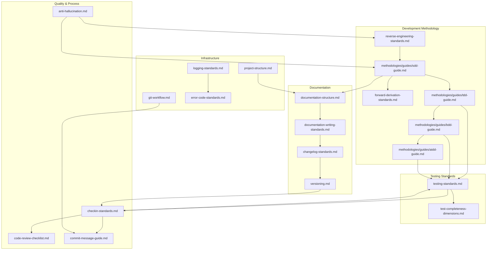

# 標準與技能對應矩陣

本文件提供核心標準與各 AI 工具實作之間的完整對應關係。

## 標準關係圖

**如何閱讀此圖**：
- 箭頭表示依賴／引用關係
- 從你的任務類型出發，找出相關標準
- 沿著箭頭探索相關標準

## 覆蓋摘要

> ⚠️ 下方各類別的細項是本專案早期（32 項標準）版本時手動維護、已過時的快照，尚未依目前 149 項標準重新清點——這四個類別列需要重新人工稽核才能再次被信任。**總計**一行已依目前原始碼重新驗證，截至 2026-07-16 為準確數字。

| 類別 | 核心標準 | AI 標準 | Claude Code 技能 | 其他 AI 工具 |
|------|---------|--------|-----------------|-------------|
| 開發 | 18 | 18 | 12 | 4 |
| 測試 | 6 | 6 | 4 | 4 |
| 文件 | 4 | 4 | 2 | 4 |
| 流程與品質 | 4 | 4 | 8 | 4 |

**總計**：149 個核心標準（`ls core/*.md`）→ 141 個 AI 標準（`ls ai/standards/*.ai.yaml`）→ 55 個 Claude Code 技能（`uds-manifest.json` 統計）→ 10 個 AI 工具整合（`cli/src/core/constants.js` 中的 `SUPPORTED_AI_TOOLS`）

## ISO 標準對齊

本節將 UDS 元件對應至國際軟體工程標準。

### ISO/IEC 12207（軟體生命週期流程）

| ISO 12207 流程群組 | 流程 | UDS 元件 | 實作 |
|-------------------|------|---------|------|
| **協議（6.1）** | 獲取（6.1.1） | `ai-agreement-standards.md` | Context Contract / RFP Prompts |
| | 供應（6.1.2） | `ai-agreement-standards.md` | 供應驗收／自我驗證 |
| **組織賦能（6.2）** | 基礎設施（6.2.2） | `virtual-organization-standards.md` | 工具整合（MCP） |
| | 人力資源（6.2.4） | `virtual-organization-standards.md` | 技能管理 |
| | 品質管理（6.2.5） | `checkin-standards.md` | Vibe Checks / CI 關卡 |
| **技術（6.4）** | 利害關係人需求（6.4.1） | `requirement-engineering.md` | 需求範本 |
| | 實作（6.4.4） | `checkin-standards.md` | 編碼標準 |
| | 驗證（6.4.7） | `testing-standards.md` | 測試金字塔 |
| | 維護（6.4.10） | `refactoring-standards.md` | 重構規程 |

### ISO/IEC 25010（系統與軟體品質模型）

| 品質特性 | UDS 元件 | 指標 |
|---------|---------|------|
| **可維護性** | `refactoring-standards.md` | 模組化、可分析性 |
| **可靠性** | `testing-standards.md` | 測試覆蓋率、容錯能力 |
| **安全性** | `security-standards.md` | 機密性、完整性 |
| **效能效率** | `performance-standards.md` | 時間行為、資源使用率 |
| **易用性** | `accessibility-standards.md` | 可操作性、無障礙 |

## 核心標準矩陣

| 核心標準 | AI 標準 | Claude Code 技能 | Cursor | Windsurf | Cline | Copilot |
|---------|--------|-----------------|--------|----------|-------|---------|
| ai-agreement-standards.md | - | contract-auditor（規劃中） | ✅ | ✅ | ✅ | ✅ |
| virtual-organization-standards.md | - | hr-manager（規劃中） | ✅ | ✅ | ✅ | ✅ |
| refactoring-standards.md | ✅ refactoring-standards.ai.yaml | refactoring-assistant | ✅ | ✅ | ✅ | ✅ |
| anti-hallucination.md | ✅ | ai-collaboration-standards | ✅ | ✅ | ✅ | ✅ |
| commit-message-guide.md | ✅ commit-message.ai.yaml | commit-standards | ✅ | ✅ | ✅ | ✅ |
| code-review-guide.md | ✅ code-review.ai.yaml | code-review-assistant | ✅ | ✅ | ✅ | ✅ |
| git-workflow.md | ✅ git-workflow.ai.yaml | git-workflow-guide | ✅ | ✅ | ✅ | ✅ |
| testing-standards.md | ✅ testing.ai.yaml | testing-guide | ✅ | ✅ | ✅ | ✅ |
| versioning.md | ✅ | release-standards | ✅ | ✅ | ✅ | ✅ |
| changelog-standards.md | ✅ changelog.ai.yaml | release-standards | ✅ | ✅ | ✅ | ✅ |
| documentation-structure.md | ✅ documentation-structure.ai.yaml | documentation-guide | ✅ | ✅ | ✅ | ✅ |
| requirements-template.md | ✅ | requirement-assistant | ✅ | ✅ | ✅ | ✅ |
| project-structure.md | ✅ project-structure.ai.yaml | project-structure-guide | ✅ | ✅ | ✅ | ✅ |
| test-completeness-dimensions.md | ✅ | testing-guide | ✅ | ✅ | ✅ | ✅ |
| api-documentation-standards.md | ✅ | documentation-guide | ✅ | ✅ | ✅ | ✅ |
| logging-standards.md | ✅ logging.ai.yaml | logging-guide | ✅ | ✅ | ✅ | ✅ |
| error-code-standards.md | ✅ error-codes.ai.yaml | error-code-guide | ✅ | ✅ | ✅ | ✅ |
| test-driven-development.md | ✅ | tdd-assistant | ✅ | ✅ | ✅ | ✅ |
| spec-driven-development.md | ✅ | spec-driven-dev | ✅ | ✅ | ✅ | ✅ |
| accessibility-standards.md | ✅ | - | ✅ | ✅ | ✅ | ✅ |
| security-standards.md | ✅ | - | ✅ | ✅ | ✅ | ✅ |
| performance-standards.md | ✅ | - | ✅ | ✅ | ✅ | ✅ |
| requirement-engineering.md | ✅ | requirement-assistant | ✅ | ✅ | ✅ | ✅ |
| reverse-engineering-standards.md | ✅ | reverse-engineer | ✅ | ✅ | ✅ | ✅ |
| forward-derivation-standards.md | ✅ | spec-derivation | ✅ | ✅ | ✅ | ✅ |
| acceptance-test-driven-development.md | ✅ | atdd-assistant | ✅ | ✅ | ✅ | ✅ |
| behavior-driven-development.md | ✅ | bdd-assistant | ✅ | ✅ | ✅ | ✅ |
| ai-friendly-architecture.md | ✅ | ai-friendly-architecture | ✅ | ✅ | ✅ | ✅ |
| ai-instruction-standards.md | ✅ | ai-instruction-standards | ✅ | ✅ | ✅ | ✅ |
| developer-memory.md | ✅ | - | ✅ | ✅ | ✅ | ✅ |
| project-context-memory.md | ✅ | project-discovery | ✅ | ✅ | ✅ | ✅ |
| deployment-standards.md | ✅ | - | ✅ | ✅ | ✅ | ✅ |

圖例：✅ = 已實作 | - = 不適用作為獨立技能

## AI 選項覆蓋

### 測試選項

| 選項 | AI 標準 | 語言/框架 |
|-----|--------|----------|
| 單元測試 | ✅ unit-testing.ai.yaml | 全部 |
| 整合測試 | ✅ integration-testing.ai.yaml | 全部 |
| 系統測試 | ✅ system-testing.ai.yaml | 全部 |
| 端對端測試 | ✅ e2e-testing.ai.yaml | 全部 |
| 安全測試 | ✅ security-testing.ai.yaml | 全部 |
| 效能測試 | ✅ performance-testing.ai.yaml | 全部 |
| 契約測試 | ✅ contract-testing.ai.yaml | 微服務 |
| ISTQB 框架 | ✅ istqb-framework.ai.yaml | 企業級 |
| 業界金字塔 | ✅ industry-pyramid.ai.yaml | 敏捷 |

### 專案結構選項

| 語言 | AI 標準 | 框架 |
|-----|--------|------|
| Node.js | ✅ nodejs.ai.yaml | Express, NestJS, Next.js |
| Python | ✅ python.ai.yaml | Django, Flask, FastAPI |
| Java | ✅ java.ai.yaml | Spring Boot, Maven |
| .NET | ✅ dotnet.ai.yaml | ASP.NET Core |
| Go | ✅ go.ai.yaml | 標準佈局 |
| Rust | ✅ rust.ai.yaml | Binary, Library, Workspace |
| Kotlin | ✅ kotlin.ai.yaml | Gradle, Android, KMP |
| PHP | ✅ php.ai.yaml | Laravel, Symfony |
| Ruby | ✅ ruby.ai.yaml | Rails, Sinatra, Gem |
| Swift | ✅ swift.ai.yaml | SPM, iOS, Vapor |

### Git 工作流程選項

| 工作流程 | AI 標準 | 最適合 |
|---------|--------|-------|
| GitHub Flow | ✅ github-flow.ai.yaml | 小團隊、CI/CD |
| Git Flow | ✅ git-flow.ai.yaml | 定期發布 |
| Trunk-Based | ✅ trunk-based.ai.yaml | 高部署頻率 |
| GitLab Flow | ✅ gitlab-flow.ai.yaml | 環境分支 |

### 變更日誌選項

| 風格 | AI 標準 | 最適合 |
|-----|--------|-------|
| Keep a Changelog | ✅ keep-a-changelog.ai.yaml | 手動策展 |
| 自動產生 | ✅ auto-generated.ai.yaml | CI/CD 自動化 |

### 程式碼審查選項

| 方式 | AI 標準 | 最適合 |
|-----|--------|-------|
| PR 審查 | ✅ pr-review.ai.yaml | 非同步團隊 |
| 配對程式設計 | ✅ pair-programming.ai.yaml | 即時協作 |
| 自動化審查 | ✅ automated-review.ai.yaml | CI/CD 整合 |

### 文件選項

| 風格 | AI 標準 | 最適合 |
|-----|--------|-------|
| Markdown 文件 | ✅ markdown-docs.ai.yaml | 程式碼儲存庫 |
| API 文件 | ✅ api-docs.ai.yaml | REST/GraphQL API |
| Wiki 風格 | ✅ wiki-style.ai.yaml | 知識庫 |

## Claude Code 技能詳情

| 技能 | 目錄 | 檔案 | 使用者可呼叫 |
|-----|-----|-----|------------|
| AI 協作標準 | ai-collaboration-standards/ | SKILL.md, anti-hallucination.md, certainty-labels.md | ✅ |
| 變更日誌指南 | changelog-guide/ | SKILL.md | ✅ |
| 程式碼審查助手 | code-review-assistant/ | SKILL.md, checkin-checklist.md, review-checklist.md | ✅ |
| 提交標準 | commit-standards/ | SKILL.md, conventional-commits.md, language-options.md | ✅ |
| 文件指南 | documentation-guide/ | SKILL.md, documentation-structure.md, readme-template.md | ✅ |
| 錯誤碼指南 | error-code-guide/ | SKILL.md | ✅ |
| Git 工作流程指南 | git-workflow-guide/ | SKILL.md, branch-naming.md, git-workflow.md | ✅ |
| 日誌指南 | logging-guide/ | SKILL.md | ✅ |
| 專案結構指南 | project-structure-guide/ | SKILL.md, language-patterns.md | ✅ |
| 發布標準 | release-standards/ | SKILL.md, changelog-format.md, semantic-versioning.md, release-workflow.md | ✅ |
| 需求助手 | requirement-assistant/ | SKILL.md, requirement-checklist.md, requirement-writing.md | ✅ |
| 規格驅動開發 | spec-driven-dev/ | SKILL.md | ✅ |
| TDD 助手 | tdd-assistant/ | SKILL.md, tdd-workflow.md, language-examples.md | ✅ |
| 測試覆蓋助手 | test-coverage-assistant/ | SKILL.md | ✅ |
| 測試指南 | testing-guide/ | SKILL.md, testing-pyramid.md | ✅ |

## 本地化覆蓋

| 語言 | 核心 | AI 標準 | AI 選項 | 技能 |
|-----|-----|--------|--------|-----|
| English | 16/16 | 16/16 | 35/35 | 15/15 |
| 繁體中文 (zh-TW) | 16/16 | 16/16 | 35/35 | 15/15 |
| 简体中文 (zh-CN) | 5/16 | 0/16 | 0/35 | 0/15 |

## AI 工具整合

| 工具 | 檔案 | 格式 | 狀態 |
|-----|-----|-----|-----|
| Claude Code | skills/**/*.md | SKILL.md | ✅ 完成 |
| Cursor | skills/cursor/.cursorrules | Rules 檔案 | ✅ 完成 |
| Windsurf | skills/windsurf/.windsurfrules | Rules 檔案 | ✅ 完成 |
| Cline | skills/cline/.clinerules | Rules 檔案 | ✅ 完成 |
| GitHub Copilot | skills/copilot/copilot-instructions.md | Markdown | ✅ 完成 |

## 統計

### 依類別

| 類別 | 數量 |
|-----|-----|
| 核心標準 (Markdown) | 16 |
| AI 標準 (YAML) | 16 |
| AI 選項 (YAML) | 35 |
| Claude Code 技能 | 15 |
| AI 工具整合 | 4 |
| 支援語言 | 10 |
| 本地化 | 3 |

### 檔案類型

| 副檔名 | 數量 | 用途 |
|-------|-----|-----|
| .md | ~60 | 人類可讀文件 |
| .ai.yaml | ~50 | AI 優化標準 |
| .cursorrules | 1 | Cursor 規則 |
| .windsurfrules | 1 | Windsurf 規則 |
| .clinerules | 1 | Cline 規則 |

## 版本歷史

| 版本 | 日期 | 變更 |
|-----|-----|-----|
| 1.1.0 | 2026-01-07 | 新增 TDD 標準和 tdd-assistant 技能，更新至 15 個技能 |
| 1.0.0 | 2025-12-30 | 初始對應矩陣 |
